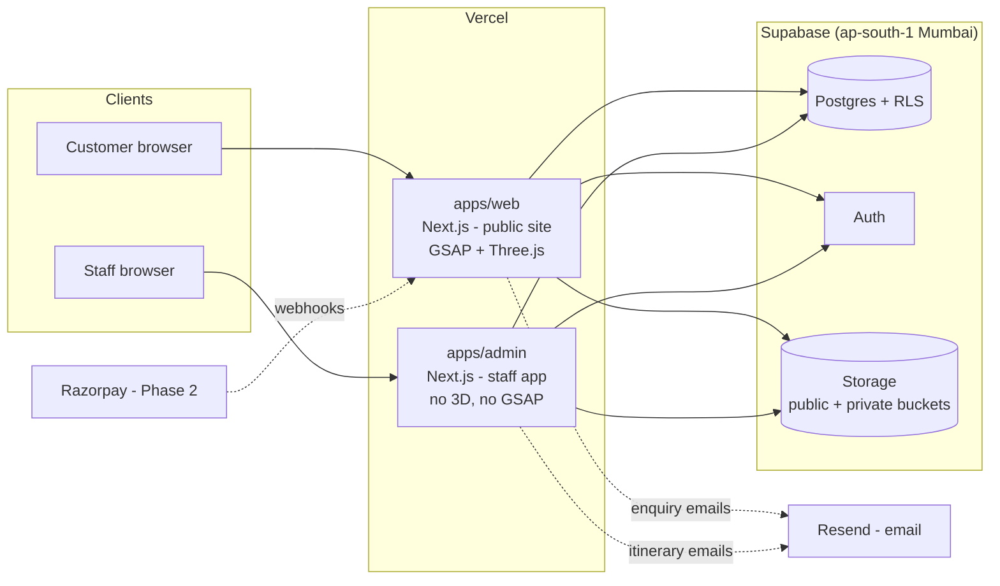
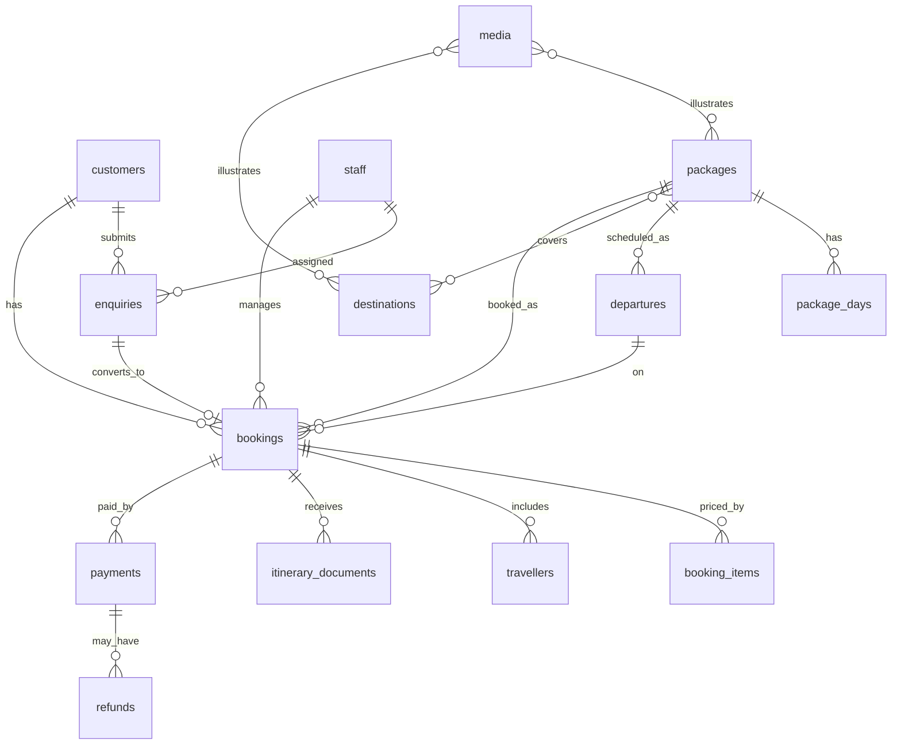

# Travel Agency Platform — Architecture & Data Model (Draft for Approval)

Status: **Approved. Phase 0 in progress** — monorepo, both Next.js apps (default scaffold) and the Supabase schema + RLS migrations exist. Open questions in §14 were not yet answered, so Phase 0 assumes both product types (fixed departures and custom trips) and no separate quotes table.
Scope: customer-facing immersive site + separate staff admin app. Razorpay is designed for but not integrated in Phase 1.

---

## 1. Working assumptions (correct me if wrong)

- Indian company (Bengaluru), customers mostly in India, majority on mobile, often mid-range Android on variable networks.
- Sells **fixed-departure packages** and **custom/bespoke trips** (both modelled; see open questions).
- Currency INR only at launch; money stored as integer paise.
- Staff team is small (roughly 3–15 people) with a few distinct roles.
- Booking is **staff-confirmed** at first (enquiry → staff follow-up → booking). Self-serve checkout arrives with Razorpay.
- English first; i18n (Hindi/Kannada) is not designed in, but nothing blocks it.

---

## 2. System overview



Key idea: **one database, two apps, hard boundary between them.** The apps share a schema and typed client package but are deployed, authenticated and bundled separately.

---

## 3. Repository & deployment

**Monorepo** (pnpm workspaces + Turborepo):

```
apps/
  web/        customer site          -> www.<domain>
  admin/      staff app              -> admin.<domain>
packages/
  db/         SQL migrations, generated TS types, typed query helpers
  ui/         shared primitives (buttons, form fields, tokens) — small
  config/     tsconfig, eslint, tailwind preset
supabase/     config.toml, migrations/, seed.sql, tests (pgTAP for RLS)
```

**Why two apps, not one with `/admin` routes**
- The admin never ships Three.js/GSAP; the public site never ships admin code.
- Separate cookie scope/domain — a bug or XSS on the marketing site can't ride a staff session.
- Independent deploys: marketing tweaks don't risk the booking tool, and vice versa.
- Can later put the admin behind IP allow-list / Vercel deployment protection / Cloudflare Access with no impact on the public site.

**Cost of this choice:** slightly more setup and a shared-package discipline. Worth it here.

**Hosting:** two Vercel projects (one per app), one Supabase project per environment (local via Supabase CLI, staging, production). Supabase region **Mumbai (ap-south-1)** for latency and data residency.

---

## 4. Customer site (`apps/web`)

### Rendering strategy
- App Router, **Server Components by default**. Catalogue pages (destinations, packages) are statically generated/cached and revalidated when staff publish (on-demand revalidation tag from admin → web via a signed webhook route).
- All SEO-critical content (titles, itineraries, prices, FAQs) is real HTML. **Nothing important lives only inside the WebGL canvas.**
- Immersive pieces are **client islands**, dynamically imported and loaded after first paint.

### Immersive layer
- **Three.js via react-three-fiber + drei** (recommended over raw Three.js: lifecycle with React is cleaner, less glue code). One persistent, lazily-mounted canvas for hero/globe moments rather than a canvas per section.
- **GSAP + ScrollTrigger** drives scroll choreography; the 3D scene reads a scroll-progress value rather than owning its own timeline logic.
- Per-package/destination `scene_config` (JSON in DB) lets staff-editable parameters (palette, camera waypoint, model key) vary without a deploy — kept deliberately small.

### Performance & resilience (this is where immersive sites fail)
- Budgets (proposed): initial JS ≤ ~150 KB gzip before the 3D chunk; LCP < 2.5 s on throttled mid-range mobile; 3D chunk loads only after LCP and only when the device qualifies.
- Capability gating: `prefers-reduced-motion`, low device memory/CPU hint, Save-Data, and WebGL-unavailable → **static poster + CSS/GSAP-lite fallback**. No broken page ever.
- Assets: glTF with Draco/Meshopt + KTX2 textures; images via `next/image` with AVIF/WebP; video posters instead of autoplay video on mobile.
- Pause rendering when off-screen / tab hidden; cap DPR (≤ 1.5–2); one render loop.
- Accessibility: all motion has a reduced variant; focus order and keyboard nav unaffected by the canvas; text contrast verified over moving backgrounds.

### Customer-side features by phase
1. Browse destinations/packages, package detail with day-by-day itinerary, enquiry form (guest, no login).
2. Customer account ("My trips"): view booking, download published itinerary, pay balance.
3. Razorpay checkout, deposits, invoices.

### Public write paths
Only two: **create enquiry** and (later) **create payment order**. Both go through Server Actions / route handlers that validate (Zod), rate-limit, and verify a bot challenge (Cloudflare Turnstile recommended). The browser never gets a role with broad insert rights.

---

## 5. Staff admin (`apps/admin`)

Modules (Phase 1 in bold):
- **Enquiries inbox** — status pipeline, assignment, internal notes, convert to booking.
- **Bookings** — list/filter, detail (travellers, line items, status, payments ledger, timeline).
- **Itinerary uploads** — attach PDF(s) to a booking, versioned, with explicit "Publish to customer" (and optional email).
- **Catalogue (destinations, packages, days, departures, media)** — this app *is* the CMS; no separate CMS vendor.
- **Customers** — profile, history.
- Staff & roles management (owner only).
- Audit log viewer.
- Phase 2: record offline payments, refunds, Razorpay reconciliation view, reports/exports.

Stack: Next.js + Tailwind + shadcn/ui (data tables, forms), TanStack Table for lists, server-side pagination/filtering.

---

## 6. Authentication & authorization

- **Single Supabase Auth project**, two populations distinguished by data, not by separate auth systems:
  - **Staff:** invite-only (no public sign-up), email + password with **mandatory TOTP MFA**. A row in `staff` (role, active) is required; admin app rejects any user without one.
  - **Customers:** passwordless — email magic link/OTP (phone OTP deferred: needs an SMS provider, DLT registration in India, and cost). Optional at launch; guests can enquire.
- **Authorization = Postgres Row Level Security** on every table (default deny). The app layer is a second check, not the only one.
- Roles: `owner`, `manager`, `agent`, `content_editor`, (`accounts` Phase 2).
- Role is read in RLS from the `staff` table via a `SECURITY DEFINER` helper (`is_staff()`, `staff_role()`), avoiding stale JWT claims after a role change.
- **Service-role key** exists only server-side in the admin app (for the few operations RLS can't express, e.g. inviting staff) and in `apps/web` in exactly two server-only routes: enquiry submission (after Turnstile + rate-limit; there is no anon insert policy on `enquiries`) and the Razorpay webhook handler. Never shipped to a browser.

### RLS summary

| Table group | anon | customer | staff |
|---|---|---|---|
| Catalogue (published rows) | read | read | read/write by role (`content_editor`+) |
| Enquiries | insert via server only | read own | read/write (agent: assigned or unassigned; manager+: all) |
| Bookings, travellers, items | — | read own | read/write by role |
| Itinerary docs | — | read own **if published** | read/write |
| Payments | — | read own | read; write limited to `accounts`/`manager`+ |
| Audit log | — | — | read: manager+; insert: system only |

---

## 7. Data model

Conventions: `uuid` PKs (`gen_random_uuid()`), `created_at`/`updated_at` timestamptz on everything, money as `bigint` paise + `currency char(3) default 'INR'`, soft-delete via `archived_at` for catalogue, enums for statuses, all FKs indexed.

### ER overview



### Identity

**`staff`** — `id` (= `auth.users.id`), `full_name`, `role` (enum), `active`, `phone`
**`customers`** — `id`, `auth_user_id` (nullable, unique), `full_name`, `email` (citext, unique nullable), `phone`, `marketing_consent` + `consent_at`, `notes`
 *Customers can exist without a login (created from a phone enquiry by staff); `auth_user_id` is linked when they sign in with a verified matching email.*

### Catalogue

**`destinations`** — `slug` (unique), `name`, `country`, `region`, `summary`, `lat`, `lng` (for globe markers), `hero_media_id`, `status` (draft/published), `sort_order`
**`packages`** — `slug` (unique), `title`, `summary`, `description`, `duration_days`, `base_price_paise`, `price_note`, `inclusions text[]`, `exclusions text[]`, `highlights text[]`, `tags text[]`, `is_domestic`, `status` (draft/published/archived), `seo_title`, `seo_description`, `scene_config jsonb`, `search tsvector` (generated; Postgres FTS is sufficient, no external search service)
**`package_destinations`** — `package_id`, `destination_id` (M:N)
**`package_days`** — `package_id`, `day_no`, `title`, `description`, `location`, `meals`, `stay`; unique(`package_id`,`day_no`)
**`departures`** — `package_id`, `start_date`, `end_date`, `capacity`, `price_override_paise`, `status` (open/closed/sold_out/cancelled). Seats-left is **computed** from confirmed bookings (view), not a mutable counter — avoids drift and races.
**`media`** — `bucket`, `path`, `kind` (image/video/model/document), `alt`, `width`, `height`, `bytes`, `uploaded_by`
**`package_media` / `destination_media`** — join tables with `sort_order`, `role` (hero/gallery/thumb)

### Sales & operations

**`enquiries`** — `customer_id` (nullable), `name`, `email`, `phone`, `package_id` (nullable), `destination_interest`, `preferred_start`, `flexible_dates`, `adults`, `children`, `budget_note`, `message`, `source` (web/phone/walk-in/referral), `utm jsonb`, `status` (new/contacted/quoted/won/lost), `lost_reason`, `assigned_to` (staff), `consent_at`
**`bookings`** — `reference` (human-friendly, from a sequence, e.g. `BLR-26-00042`), `customer_id`, `enquiry_id` (nullable), `package_id` (nullable → custom trip), `departure_id` (nullable), `title` (for custom trips), `start_date`, `end_date`, `adults`, `children`, `status` (`pending` / `confirmed` / `completed` / `cancelled`), `total_paise`, `tax_paise`, `currency`, `assigned_to`, `internal_notes`, `cancelled_at`, `cancel_reason`, `created_by`
 *`payment_status` (unpaid/partial/paid/refunded) is **derived** from the payments ledger via a view, never stored independently.*
**`booking_items`** — `booking_id`, `description`, `quantity`, `unit_price_paise`, `tax_rate_bps`, `kind` (package/addon/discount/fee) — supports custom pricing and discounts
**`travellers`** — `booking_id`, `full_name`, `date_of_birth`, `gender`, `nationality`, `is_lead`, `passport_number` (**application-encrypted** or Supabase Vault/pgsodium — see §10), `passport_expiry`, `dietary`, `notes`
**`itinerary_documents`** — `booking_id`, `version`, `title`, `storage_path` (private bucket), `file_name`, `bytes`, `content_type`, `uploaded_by`, `published_at` (null = staff-only draft), `email_sent_at`
**`booking_events`** — `booking_id`, `type`, `actor_type` (staff/customer/system), `actor_id`, `data jsonb` — the human-readable timeline shown in admin

### Payments (schema now, integration in Phase 2)

**`payments`** — `booking_id`, `provider` (`razorpay` / `offline`), `kind` (deposit/balance/full), `amount_paise`, `currency`, `status` (created/authorized/captured/failed/refunded/partially_refunded), `razorpay_order_id` (unique), `razorpay_payment_id` (unique), `method`, `receipt`, `captured_at`, `failure_code`, `failure_reason`, `offline_reference` + `recorded_by` (for bank transfer/UPI/cash entered by staff), `raw jsonb`
**`refunds`** — `payment_id`, `amount_paise`, `razorpay_refund_id`, `status`, `reason`, `initiated_by`
**`payment_events`** — `provider_event_id` (**unique** → webhook idempotency), `type`, `payload jsonb`, `received_at`, `processed_at`, `error`

### System

**`audit_log`** — `actor_id`, `action`, `entity_type`, `entity_id`, `before jsonb`, `after jsonb`, `ip`, `at` — written by DB triggers on bookings/payments/staff/packages; append-only (no update/delete grants).
**`email_outbox`** — `to`, `template`, `payload`, `status`, `attempts`, `sent_at` — decouples sending from user requests; retried by a scheduled job.

---

## 8. File storage

| Bucket | Visibility | Contents | Access |
|---|---|---|---|
| `public-media` | public CDN | package/destination images, posters | read by anyone, write by staff (RLS on `storage.objects`) |
| `models` | public CDN | glTF/KTX2 assets for 3D | same; long cache with content-hashed names |
| `itineraries` | **private** | booking itinerary PDFs | staff via RLS; customers via **short-lived signed URLs** issued by server after checking ownership + `published_at` |
| `traveller-docs` (Phase 2, if needed) | **private** | passport scans, visas | staff `manager`+ only; signed URLs; auto-expire policy |

Upload limits: PDF only for itineraries, ≤ 20 MB, content-type + magic-byte check server-side, filenames replaced with UUIDs (original kept in DB). Direct-to-Storage uploads using signed upload URLs so large files bypass Vercel's request body limit.

---

## 9. Booking lifecycle & payment readiness

```
Enquiry: new → contacted → quoted → won ─┐ (or lost)
                                         ▼
Booking: pending → confirmed → completed   (or cancelled at any point)
                      │
                      └ payments ledger: deposit → balance (→ refund)
```

- Phase 1: staff convert an enquiry to a booking, upload the itinerary, publish it; payments are tracked as **offline** entries if staff want them (so the ledger is correct from day one).
- Phase 2 (Razorpay): server creates an Order (amount computed **server-side** from `bookings`, never from the client) → Checkout on the client → **webhook is the source of truth** (verify signature, dedupe on `payment_events.provider_event_id`, update `payments` in one transaction). Client-side success callback only triggers a refresh.
- Seat inventory is only decremented on **confirmed** bookings; holds/expiry for self-serve checkout are a Phase 2 design item.
- India-specific items to confirm with the company's accountant before Phase 2 (not hardcoded anywhere): GST rate/treatment for tour packages, TCS on overseas packages, invoice numbering series, GSTIN on invoices. The schema carries `tax_rate_bps` per line and a tax total so these can change without migrations.

---

## 10. Security, privacy & compliance

- **DPDP Act 2023** (India): explicit consent captured on forms (`consent_at`), privacy notice, purpose-limited collection, retention policy, a data-erasure/correction path. Passport/ID data is collected **only after booking confirmation**, not at enquiry.
- Sensitive fields (passport number, DOB): column-level encryption via Supabase Vault/pgsodium or app-level envelope encryption; never logged; masked in admin lists, revealed on explicit click (audited).
- Staff: MFA mandatory, invite-only, session timeout, audit log of reads of sensitive fields, optional IP allow-list for the admin domain.
- Standard web hygiene: strict CSP, secure cookies, CSRF protection (Server Actions + origin checks), Zod validation on every boundary, rate-limit + Turnstile on public forms, dependency scanning, secrets only in Vercel env vars.
- Backups: Supabase PITR enabled on production (paid plan); periodic logical export to separate storage.
- Observability: Sentry on both apps, Vercel Analytics/Speed Insights on web, structured logs for the webhook handler.

---

## 11. Environments, CI, testing

- Local: Supabase CLI (Docker) + `seed.sql` with realistic sample catalogue.
- Migrations are SQL files in the repo, reviewed in PRs, applied by CI to staging then production. **No schema changes through the dashboard.**
- CI: typecheck, lint, unit tests, **RLS tests (pgTAP)** that assert each role can/can't read and write each table, Playwright smoke tests for the enquiry flow and admin booking flow, Lighthouse budget check on the web app.
- Preview deployments per PR (staging Supabase project).

---

## 12. Proposed phases

| Phase | Outcome |
|---|---|
| **0 — Foundations** | Monorepo, Supabase schema + RLS + tests, auth (staff invite/MFA), CI, design tokens |
| **1 — Admin core** | Catalogue CRUD + media, enquiries inbox, bookings, itinerary upload/publish, audit log |
| **2 — Customer site** | Immersive home/destination/package pages, enquiry form, SEO, performance pass, capability fallbacks |
| **3 — Customer accounts** | Magic-link login, My trips, itinerary download, email notifications |
| **4 — Payments** | Razorpay (deposit/balance), webhooks, refunds, invoices, reconciliation |

Phases 1 and 2 can overlap once the schema from Phase 0 is stable.

---

## 13. Decisions I made that you may want to override

1. Two separate Next.js apps in a monorepo (vs one app with `/admin`).
2. React Three Fiber on top of Three.js (vs vanilla Three.js).
3. Supabase as the only backend (no separate API server); logic lives in Server Actions/route handlers + RLS + a few SQL functions.
4. Admin app doubles as the CMS (no Sanity/Contentful).
5. Staff-confirmed bookings first; self-serve checkout only with Razorpay.
6. Customer login optional and passwordless (email); phone OTP deferred.
7. Seats-left computed, not stored.
8. Itineraries are **uploaded PDFs** per booking (not a structured builder) — a structured custom-itinerary builder is a possible later upgrade.

---

## 14. Open questions

1. **Product types:** fixed departures only, custom trips only, or both? (Drives how central `departures` vs custom bookings are.)
2. **Domestic vs international mix** — affects tax handling, document needs (passport/visa), and copy.
3. **What is the immersive concept?** (e.g. scroll-driven globe flying between destinations, per-destination 3D scenes, hero-only). This sets the 3D asset budget and who produces the models.
4. **Do customers need accounts at launch**, or is "enquire → staff emails the itinerary" enough for v1?
5. **Quotes:** do staff need a formal quote object (versions, validity, accept/decline) before a booking, or is converting an enquiry directly fine?
6. **Staff roles:** how many people, and which of owner/manager/agent/content-editor/accounts map to them?
7. **Payment shape:** full upfront, deposit + balance, or per-traveller instalments? Any EMI/UPI-only preferences?
8. **Comms channels:** is WhatsApp a must-have notification channel (WhatsApp Business API, template approval) or email is enough initially?
9. **Domain, brand assets, and design direction** — existing brand guide, or design from scratch?
10. **Hosting/data constraints:** any client requirement on Indian data residency or on using Vercel specifically?
